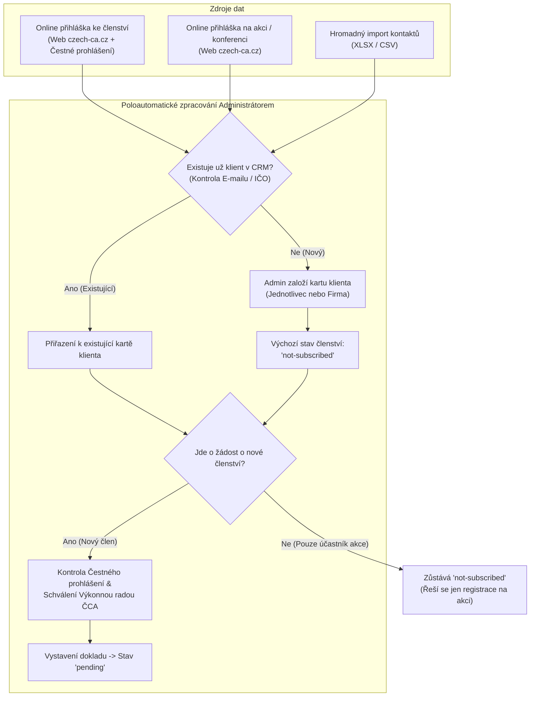
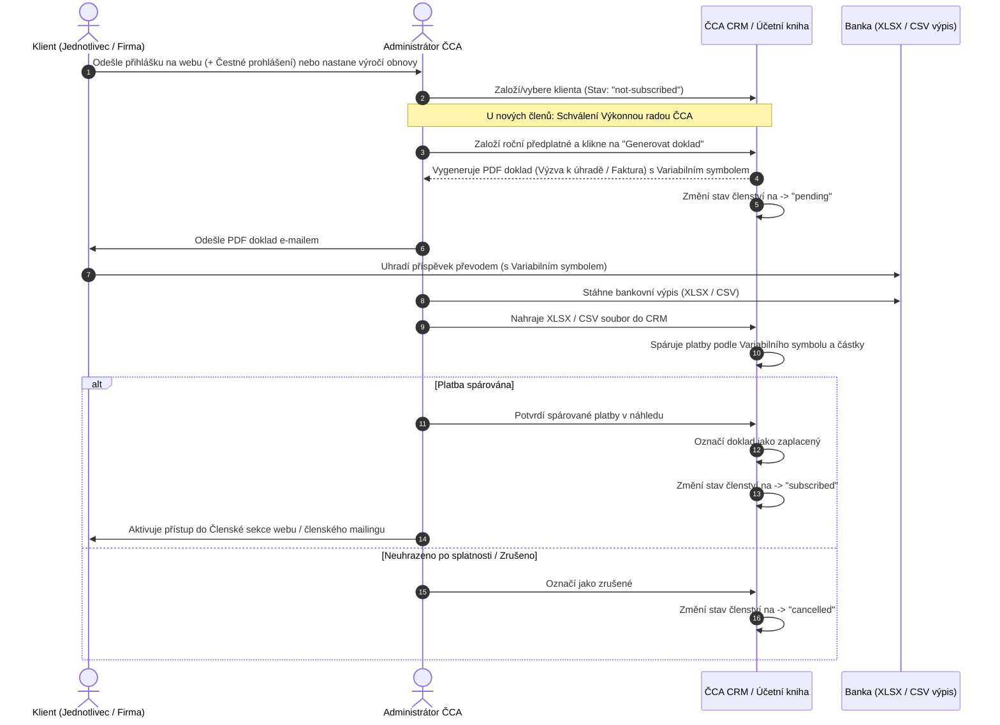
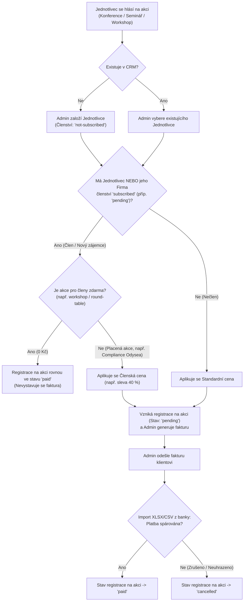
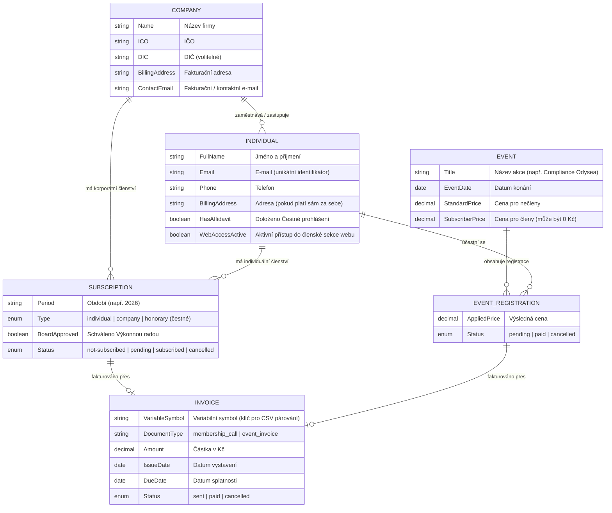
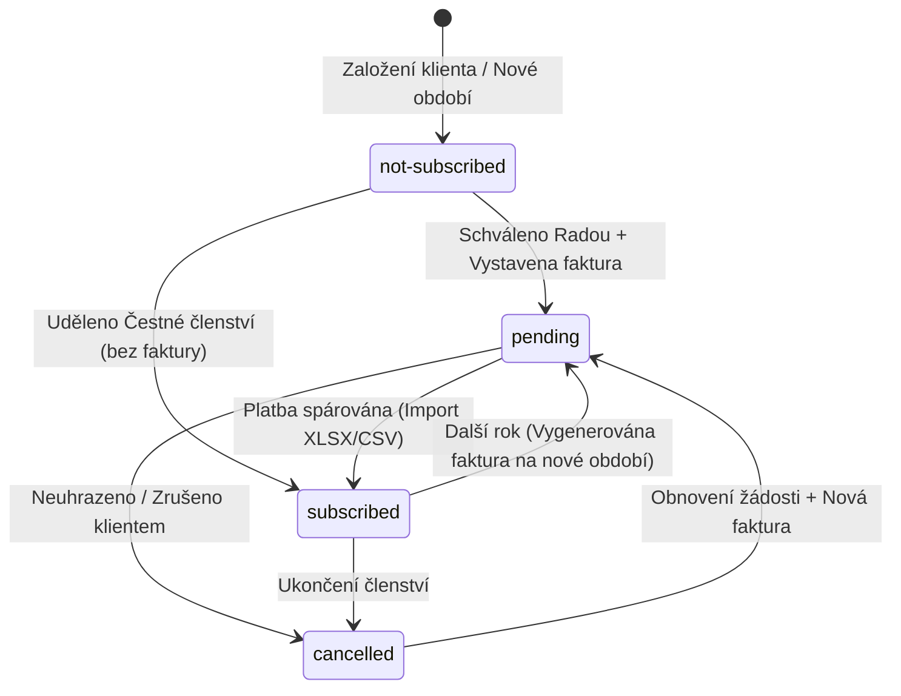
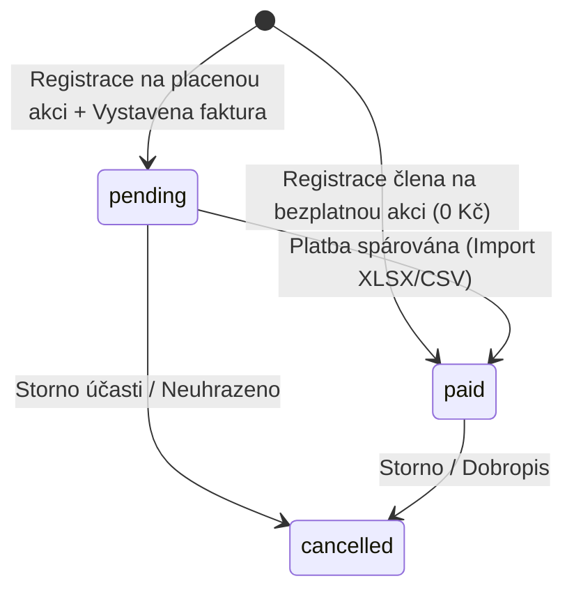
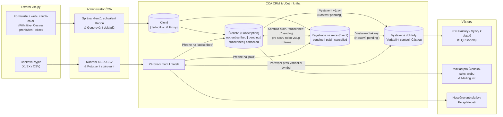

# Česká Compliance Asociace (ČCA) — Business proces správy členství, akcí a fakturace

---

# ČÁST 1: Business pohled a procesy

## 1. Shrnutí a cíl projektu
**Česká Compliance Asociace z. s. (ČCA)** potřebuje přehledný, **poloautomatický systém (jednoduché CRM a účetní knihu)** pro správu členské základny, registrací na vzdělávací akce, vystavování dokladů a párování příchozích plateb.

Cílem **není** budovat robustní samoobslužný e-shop s platební bránou a nákupním košíkem. Systém má sloužit jako **chytrý interní nástroj pro administrátora ČCA**, který navazuje na stávající web [czech-ca.cz](https://www.czech-ca.cz/), eliminuje ruční přepisování tabulek, hlídá stav členských příspěvků a umožňuje hromadné párování plateb pomocí importu bankovního výpisu (XLSX/CSV).

---

## 2. Produkty a služby ČCA (v souladu s webem czech-ca.cz)

### 2.1 Roční členství (Subscriptions)
Členství vzniká na základě online přihlášky na webu, doložení podepsaného **Čestného prohlášení** (příp. výpisu z rejstříku trestů) a **schválení Výkonnou radou ČCA**.
* **Individuální členství (Fyzické osoby)**: Roční členství pro jednotlivé compliance profesionály či zástupce akademické sféry.
* **Korporátní členství (Právnické osoby)**: Roční členství pro firmy a instituce. Výhody členství (slevy na akce, bezplatné workshopy) čerpají evidovaní zástupci/zaměstnanci dané společnosti.
* **Čestné členství**: Udělováno významným osobnostem dle Stanov ČCA. Čestný člen má trvale aktivní členství (`subscribed`), ale neplatí členský příspěvek (nevystavuje se mu faktura).

### 2.2 Vzdělávací akce, semináře a konference (Events)
Jednorázové odborné akce pořádané asociací se dělí na dva režimy:
1. **Placené konference a semináře (např. *Compliance Odysea*)**:
   * **Členská (zvýhodněná) cena** (např. sleva 40 %): Platí pro aktivní členy (`subscribed`), zaměstnance korporátních členů a také pro **nově registrované zájemce o členství** (kteří již podali přihlášku a čekají na vypořádání – stav `pending`).
   * **Standardní cena**: Platí pro nečleny (`not-subscribed` nebo `cancelled`).
2. **Bezplatné členské akce (workshopy, webináře, round-table setkání)**:
   * Pro aktivní členy (`subscribed`) jsou **zcela zdarma (0 Kč)** – při registraci se nevystavuje faktura a účast je rovnou potvrzena (`paid`).

---

## 3. Jak vzniká klient a členství (Onboarding proces)

Klienti (jednotlivci i firmy) si nevytvářejí e-shopové účty. Do CRM se dostávají třemi způsoby:
1. **Online přihláška z webu `czech-ca.cz` / E-mail**: Zájemce vyplní přihlášku ke členství (včetně skenu Čestného prohlášení) nebo registrační formulář na akci.
2. **Úvodní / hromadný import (XLSX/CSV)**: Jednorázové nahrání stávající členské základny nebo prezenční listiny z formuláře.
3. **Ruční založení administrátorem**: Administrátor ČCA zadá klienta přímo v rozhraní systému (např. přidá nového zaměstnance pod existující korporátní firmu).

---

## 4. Hlavní business procesy

### 4.1 Proces ročního členství, fakturace a párování plateb
Tento proces pokrývá jak přijetí nového člena, tak každoroční obnovu členských příspěvků (kde již odpadá schvalování Výkonnou radou).

### 4.2 Proces registrace na akci (Seminář / Konference / Workshop)
Při přihlášení jednotlivce na akci systém vyhodnotí, zda má nárok na členskou cenu (nebo vstup zdarma), a podle toho připraví podklady pro fakturaci.

---

## 5. Nápady na optimalizaci a zjednodušení práce

Aby systém zůstal jednoduchý na vývoj i každodenní používání (žádný složitý e-shop), ale ušetřil maximum ruční práce:

1. **Jeden XLSX/CSV import spáruje členské příspěvky i akce najednou**
   * Každý vygenerovaný doklad dostane unikátní **Variabilní symbol** (např. řada `20261xxx` pro členské příspěvky a `20262xxx` pro konference/semináře).
   * Když Admin nahraje výpis z banky, systém podle Variabilního symbolu sám pozná, zda má přepnout členství (`pending` $\rightarrow$ `subscribed`) nebo registraci na akci (`pending` $\rightarrow$ `paid`).
2. **Kontrolní náhled (Preview) před potvrzením importu z banky**
   * Po nahrání XLSX/CSV souboru systém nic nepřepíše naslepo. Zobrazí přehlednou tabulku:
     * **Zeleně (Spárováno)**: Variabilní symbol i částka sedí $\rightarrow$ Admin potvrdí jedním tlačítkem.
     * **Žlutě (Rozdíl v částce / Neznámý VS)**: Platba přišla, ale nesedí částka nebo chybí VS $\rightarrow$ Admin může platbu ručně přiřadit ke konkrétnímu klientovi ve stavu `pending`.
     * **Šedě (Ostatní pohyby)**: Běžné provozní výdaje spolku (nájem, služby) $\rightarrow$ systém je bezpečně ignoruje.
3. **QR Platba na každém PDF dokladu**
   * Automatické vložení českého QR kódu (`QR Platba`) s předvyplněným účtem, částkou a Variabilním symbolem přímo do PDF faktury/výzvy. Klienti při platbě z mobilu neudělají překlep ve Variabilním symbolu a úmrtnost automatického párování klesne na minimum.
4. **Automatické načtení firmy z ARES podle IČO**
   * Při zadávání korporátního člena nebo fakturačních údajů stačí zadat 8místné **IČO** – název společnosti, sídlo a DIČ se dotáhnou automaticky z registru ARES.
5. **Hromadné generování obnovy členství (1-Click Renewal)**
   * Na začátku nového členského období Admin vyfiltruje všechny aktivní členy (`subscribed` kromě čestných členů) a jedním tlačítkem jim vygeneruje výzvy k úhradě na další rok (stav se přepne na `pending`).
6. **Dvě šablony PDF dokladů (Příspěvek spolku vs. Faktura za akci)**
   * Protože je ČCA zapsaný spolek (`z. s.`), systém může používat textově odlišnou šablonu pro *Výzvu k úhradě členského příspěvku* a standardní *Fakturu* pro komerční vstupné na konferenci (*Compliance Odysea*).
7. **Přehled pro správu Členské sekce webu (`czech-ca.cz`)**
   * Jednoduchý filtr „Nově zaplacení členové (`subscribed`) bez aktivovaného přístupu na web“ a „Zrušení členové (`cancelled`)“, aby Admin přesně věděl, komu zapnout nebo vypnout přístup do členské sekce na webu a komu posílat členský newsletter.

---
---

# ČÁST 2: Techničtější pohled (Datový a stavový model)

## 6. Doménový model (Entity-Relationship Diagram)

Systém odděluje evidenci **Klientů (Firmy a Jednotlivci)** od **Členství (Subscription)**, **Akcí (Event)** a **Dokladů (Invoice)**. Díky tomu má ČCA kompletní historii, kdo byl členem ve kterém roce a kterých akcí se zúčastnil.

---

## 7. Stavové modely (State Diagrams)

### 7.1 Stavový model Členství (Subscription Status)
* **`not-subscribed`**: Klient je v databázi (např. přišel jen na seminář, nebo teprve podal přihlášku a čeká na schválení Výkonnou radou), zatím mu nebyla odeslána výzva k platbě na dané období.
* **`pending`**: Výkonná rada členství schválila (nebo jde o obnovu), Admin vygeneroval a odeslal fakturu/výzvu k platbě. Čeká se na platbu. *(Zakládá nárok na zvýhodněnou cenu konference pro nové zájemce).*
* **`subscribed`**: Platba byla spárována přes XLSX/CSV import z banky (případně jde o Čestného člena). Členství je plně aktivní.
* **`cancelled`**: Zájemce členství zrušil, nezaplatil ani po upomínkách, nebo členství ukončil.

### 7.2 Stavový model Registrace na akci (Event Registration Status)
* **`pending`**: Účastník je přihlášen na placenou akci, faktura byla vygenerována a odeslána. Čeká se na platbu.
* **`paid`**: Platba byla spárována přes XLSX/CSV import z banky **NEBO** jde o bezplatnou akci (0 Kč) pro aktivního člena (`subscribed`).
* **`cancelled`**: Účastník registraci stornoval nebo fakturu neuhradil.

---

## 8. Diagram toku dat (Data Flow Diagram)

Diagram ukazuje, jak spolu komunikují vstupy z webu `czech-ca.cz`, zásahy Administrátora, databáze CRM a importovaný bankovní výpis (XLSX/CSV).

---

## 9. Otevřené otázky k dořešení

1. **Členská sekce na webu (`czech-ca.cz`)**: Jak dnes probíhá aktivace přístupu do členské sekce webu po zaplacení? Zakládá Admin účet ručně ve WordPressu/redakčním systému webu, nebo stačí ze systému vyexportovat seznam aktivních e-mailů (`subscribed`)?
2. **Hromadná faktura za akci pro firmu**: Když korporátní člen (nebo nečlenská firma) pošle na konferenci *Compliance Odysea* 4 zaměstnance, vystavujete **jednu společnou fakturu na firmu** (jejíž zaplacení přepne všech 4 účastníků z `pending` na `paid`), nebo každému účastníkovi zvlášť?
3. **Kalendářní rok vs. klouzavých 12 měsíců**: Platí členský příspěvek vždy na **kalendářní rok** (např. 1. 1. – 31. 12., dle *Příspěvkového řádu ČCA*), nebo 12 měsíců od data zaplacení?
4. **Zdroj XLSX/CSV souboru**: Ze které banky (např. Fio, ČSOB, KB, Raiffeisenbank) budete primárně stahovat XLSX/CSV výpisy pro párování plateb?
